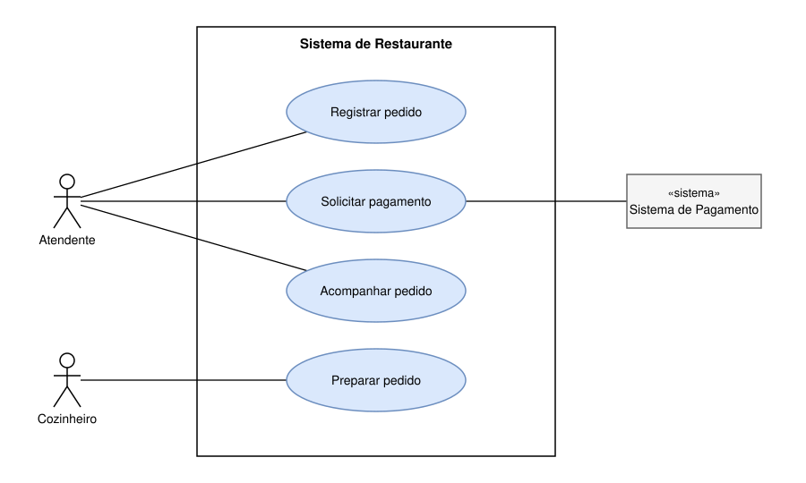

# Sistema de Restaurante: Especificação de Caso de Uso

## Diagrama de casos de uso

| Elemento | Descrição |
| --- | --- |
| Fronteira | Sistema de Restaurante |
| Atores principais | Atendente, Cozinheiro |
| Ator secundário | «sistema» Sistema de Pagamento |
| Casos de uso | Registrar pedido, Solicitar pagamento, Acompanhar pedido, Preparar pedido |

**Associações**

- Atendente: Registrar pedido, Solicitar pagamento e Acompanhar pedido
- Cozinheiro: Preparar pedido
- Sistema de Pagamento: Solicitar pagamento

---

## Caso de uso: Registrar pedido

**Ator principal:** O atendente.

**Descrição:** O atendente registra no sistema os itens que o cliente pediu, para que a cozinha possa preparar o pedido.

**Gatilho:** O cliente faz o pedido ao atendente.

**Pré-condição:** O atendente entrou no sistema com o seu usuário e o cardápio está cadastrado.

**Pós-condição:** O pedido fica registrado, aguardando preparo, e aparece na fila da cozinha.

### Fluxo principal

1. O atendente pede para criar um novo pedido e informa a mesa do cliente.
2. O sistema mostra o cardápio com os itens disponíveis.
3. O atendente seleciona os itens e as quantidades pedidas pelo cliente.
4. O sistema confere se todos os itens selecionados estão disponíveis.
5. O sistema mostra um resumo do pedido com o valor total.
6. O atendente confirma o pedido.
7. O sistema registra o pedido e o envia para a fila da cozinha.

### Fluxo alternativo: Oferecer outra opção

**Quando:** No passo 4, um item selecionado está indisponível e o cliente aceita trocá-lo por outro.

**Passos:**

1. O sistema avisa que o item está indisponível e sugere itens semelhantes do cardápio.
2. O atendente informa a escolha do cliente e o sistema substitui o item no pedido.

**Retorno:** O fluxo volta ao passo 4.

### Exceção: Cliente não aceita outra opção

**Quando:** No passo 4, um item selecionado está indisponível e o cliente não aceita nenhuma outra opção.

**Passos:**

1. O atendente cancela o pedido.
2. O sistema descarta o pedido.

**Retorno:** O caso de uso termina sem registrar o pedido.
